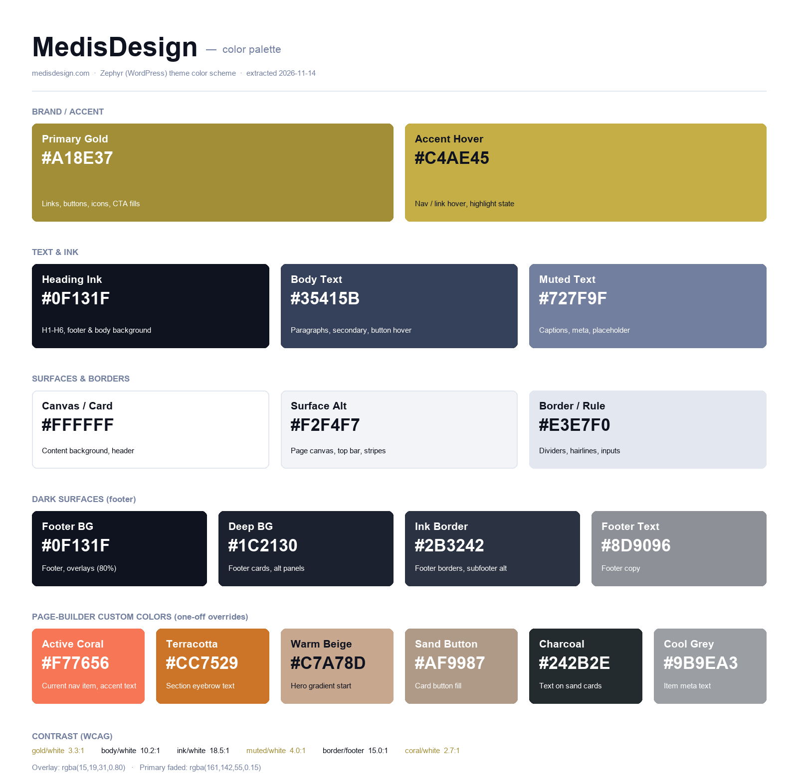

# MedisDesign — Color Palette

Extracted from the live site **https://medisdesign.com/** on 2026-11-14.

Source of truth: the Zephyr (WordPress / UpSolution) theme color scheme emitted as
CSS custom properties in the page head — `--color-content-*`, `--color-header-*`,
`--color-footer-*`, `--color-subfooter-*`, `--color-alt-content-*` (85 variables total).
Cross-checked against inline custom CSS (`.us-btn-style_1/2`), frequency analysis of
colors in the rendered page, and the ported tokens in [`app/globals.css`](../app/globals.css#L68-L82).



---

## 1. Brand / accent

| Role | Hex | RGB | Used for |
|---|---|---|---|
| **Primary gold** | `#a18e37` | 161, 142, 55 | Links, `.us-btn-style_1` fill, icons, footer links |
| **Accent hover** | `#c4ae45` | 196, 174, 69 | Nav + header link hover, highlight state |

The accent is a muted **antique gold / brass** (hue ≈ 44°, HSL 48% 42%). Inside the theme
scheme it is the only chromatic color — everything else is blue-grey or neutral.

### 1b. Page-builder custom colors (hard-coded overrides)

These are **not** theme variables: they are per-element custom CSS classes
(`.us_custom_*`) written in WPBakery, so they apply only to specific sections.

| Role | Hex | RGB | Where |
|---|---|---|---|
| **Active coral** | `#f77656` | 247, 118, 86 | Current menu item (`.current-page-ancestor`), accent headings |
| **Terracotta** | `#cc7529` | 204, 117, 41 | Section eyebrow / label text |
| **Warm beige** | `#c7a78d` | 199, 167, 141 | Hero section gradient start (→ `rgba(0,0,0,0.70)`) |
| **Sand button** | `#af9987` | 175, 153, 135 | Card button / chip fill, radius 20px |
| **Charcoal** | `#242b2e` | 36, 43, 46 | Text sitting on sand cards |
| **Cool grey** | `#9b9ea3` | 155, 158, 163 | Small meta / caption text |

> Treat this row as the "warm secondary" layer. If you rebuild the site, keep it scoped to
> the same components — it does not belong in global tokens.

## 2. Text & ink

| Role | Hex | RGB | Used for |
|---|---|---|---|
| **Heading ink** | `#0f131f` | 15, 19, 31 | H1–H6, footer background, overlays |
| **Body text** | `#35415b` | 53, 65, 91 | Paragraphs, `secondary`, button hover fill |
| **Muted text** | `#727f9f` | 114, 127, 159 | Captions, meta, placeholders, header-top text |

## 3. Surfaces & borders

| Role | Hex | RGB | Used for |
|---|---|---|---|
| **Canvas / card** | `#ffffff` | 255, 255, 255 | Content background, header middle |
| **Surface alt** | `#f2f4f7` | 242, 244, 247 | Page canvas, header-top bar, alt sections |
| **Border / rule** | `#e3e7f0` | 227, 231, 240 | Dividers, hairlines, inputs |

## 4. Dark surfaces (footer)

| Role | Hex | RGB | Used for |
|---|---|---|---|
| **Footer BG** | `#0f131f` | 15, 19, 31 | Footer, 80% overlays |
| **Deep BG** | `#1c2130` | 28, 33, 48 | Footer cards, alt panels |
| **Ink border** | `#2b3242` | 43, 50, 66 | Footer borders, subfooter alt |
| **Footer text** | `#8d9096` | 141, 144, 150 | Footer copy |

## 5. Alpha / translucent

| Token | Value | Used for |
|---|---|---|
| Content overlay | `rgba(15, 19, 31, 0.80)` | Image/video overlays behind white text |
| Primary faded | `rgba(161, 142, 55, 0.15)` | Gold tint chips, hover washes |
| Top bar transparent | `rgba(0, 0, 0, 0.20)` | Header top over hero |
| Transparent header text | `rgba(255, 255, 255, 0.66)` | Header top links over hero |
| Shadow | `rgba(0, 0, 0, 0.15)` | `--box-shadow: 0 5px 15px` |

---

## 6. Theme variable map (verbatim from the live site)

```css
/* content */
--color-content-bg:              #fff;
--color-content-bg-alt:          #f2f4f7;
--color-content-heading:         #0f131f;
--color-content-text:            #35415b;
--color-content-secondary:       #35415b;
--color-content-primary:         #a18e37;
--color-content-link:            #a18e37;
--color-content-link-hover:      #35415b;
--color-content-faded:           #727f9f;
--color-content-border:          #e3e7f0;
--color-content-overlay:         rgba(15,19,31,0.80);
--color-content-primary-faded:   rgba(161,142,55,0.15);

/* header (light) */
--color-header-top-bg:           #f2f4f7;
--color-header-top-text:         #727f9f;
--color-header-top-text-hover:   #c4ae45;
--color-header-middle-bg:        #fff;
--color-header-middle-text:      #35415b;
--color-header-middle-text-hover:#c4ae45;

/* header (transparent, over hero) */
--color-header-transparent-text: rgba(255,255,255,0.66);
--color-header-transparent-text-hover: #fff;

/* footer */
--color-footer-bg:               #0f131f;
--color-footer-bg-alt:           #1c2130;
--color-footer-text:             #8d9096;
--color-footer-heading:          #fff;
--color-footer-link:             #a18e37;
--color-footer-link-hover:       #fff;
--color-footer-border:           #2b3242;

/* subfooter */
--color-subfooter-bg:            #35415b;
--color-subfooter-bg-alt:        #2b3242;
--color-subfooter-text:          #9ba5bf;
--color-subfooter-heading:       #e3e7f0;
--color-subfooter-link:          #e3e7f0;
--color-subfooter-link-hover:    #fff;
--color-subfooter-border:        #727f9f;

/* alt-content sections (light stripe) */
--color-alt-content-bg:          #f2f4f7;
--color-alt-content-bg-alt:      #fff;
--color-alt-content-heading:     #0f131f;
--color-alt-content-text:        #35415b;
--color-alt-content-primary:     #a18e37;
--color-alt-content-border:      #e3e7f0;
/* note: theme default overlay for alt sections is rgba(100,108,253,0.85) —
   an unused UpSolution blue, not part of the visible brand palette */
```

## 7. Component usage

```css
/* primary CTA */
.us-btn-style_1 { background:#a18e37; color:#fff; border-radius:0.3em; }
.us-btn-style_1:hover { background:#35415b; color:#fff; }

/* ghost / outline CTA */
.us-btn-style_2 { background:transparent; border-color:#a18e37; color:#a18e37; }
```

## 8. Accessibility notes (WCAG 2.1)

| Pair | Ratio | Verdict |
|---|---|---|
| `#0f131f` on `#ffffff` | 18.5:1 | AAA |
| `#35415b` on `#ffffff` | 10.2:1 | AAA |
| `#e3e7f0` on `#0f131f` | 15.0:1 | AAA |
| `#727f9f` on `#ffffff` | 4.0:1 | AA large only |
| `#a18e37` on `#ffffff` | 3.3:1 | Large text / UI only — **not** for body copy |
| `#f77656` on `#ffffff` | 2.7:1 | Active state only — never for body copy |

The gold accent is intentionally low-contrast: use it for fills with white text
(`#fff` on `#a18e37` = 3.3:1, acceptable for ≥18.66px bold / ≥24px), headings and
icons — not for small paragraph text on white.

## 9. Repro

```bash
# palette variables
curl -sL https://medisdesign.com/ | grep -oE '\-\-color-[a-z-]+: *[^;]+;' | sort -u

# regenerate the swatch sheet
python3 docs/make_palette_sheet.py   # → docs/color-palette.png
```
